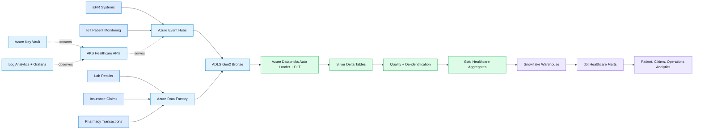

<div align="center">

# Smart Healthcare Analytics Platform on Azure

### Deployment-ready enterprise healthcare analytics platform using Azure, Databricks, Snowflake, dbt, Informatica, AKS, Terraform, FastAPI, Helm, monitoring, and GitHub Actions.


</div>

---

## Project Overview

**Smart Healthcare Analytics Platform on Azure** is a deployment-ready enterprise healthcare analytics scaffold.

The project demonstrates how healthcare data from Electronic Health Records, lab results, pharmacy transactions, appointments, imaging metadata, IoT patient monitoring, and insurance claims can move through Bronze, Silver, and Gold medallion layers using Azure, Databricks, Snowflake, dbt, Informatica, AKS, Terraform, and GitHub Actions.

---

## What Is Implemented

| Layer | Implementation |
|---|---|
| Cloud Infrastructure | ADLS Gen2, Event Hubs, ADF, AKS, ACR, Key Vault, managed identity |
| Networking | Private networking, private endpoints, secure deployment boundaries |
| Lakehouse | Databricks Delta Live Tables, Auto Loader, streaming ETL, medallion layers |
| APIs | FastAPI healthcare API, ETL worker, notification API |
| Data Quality | Ingestion contracts, validation, de-identification, quality expectations |
| Warehouse | Snowflake SQL and dbt marts |
| Healthcare Analytics | Patient analytics, claims analytics, hospital operations, executive dashboards |
| Enterprise Integration | Informatica mappings for Epic, Cerner, insurance systems, and MDM |
| Kubernetes | AKS Helm chart, Workload Identity, Key Vault CSI, autoscaling, NetworkPolicy |
| Monitoring | Log Analytics, Application Insights, Prometheus, Grafana |
| CI/CD | GitHub Actions for tests, Terraform validation, Helm rendering, Docker builds |

---

## Architecture



---

## Repository Map

```text
terraform/       Azure infrastructure modules and environments
helm-charts/     AKS Helm charts for healthcare services
services/        FastAPI APIs, ETL worker, and notification service
src/             Python ingestion contracts and shared application code
databricks/      Delta Live Tables, Auto Loader, and streaming ETL assets
dbt/             dbt marts for healthcare analytics
snowflake/       Snowflake SQL setup
informatica/     Epic, Cerner, insurance, and MDM mapping specifications
adf/             Azure Data Factory assets
monitoring/      Prometheus and Grafana monitoring assets
docs/            Deployment documentation and operational guidance
.github/         GitHub Actions quality gates and deployment workflows
```

---

## Quick Start

```powershell
python -m pip install -r requirements-dev.txt
python -m pip install -e .
python -m pytest
.\scripts\validate-local.ps1 -SkipDocker
```

For real deployment, follow:

```text
docs/DEPLOYMENT.md
```

Every `REPLACE_WITH_*` value must be replaced with account-specific Azure, Databricks, Snowflake, or Informatica details before applying to a live environment.

---

## Security And Deployment Notes

- No real secrets should be committed.
- Runtime secrets should come from Azure Key Vault, GitHub Actions secrets, Databricks secrets, Snowflake key-pair auth, or Informatica secure configuration.
- AKS uses Workload Identity and Key Vault CSI.
- Private endpoints and private networking are included for secure deployment boundaries.
- Local validation is not proof that external systems have been deployed or connected.

---

## Author

**Sujoy Halder**  
Azure | Data Engineering | Databricks | Snowflake | dbt | AKS | Terraform | FastAPI | CI/CD

<div align="center">

### Built for enterprise healthcare analytics and cloud data engineering


</div>
